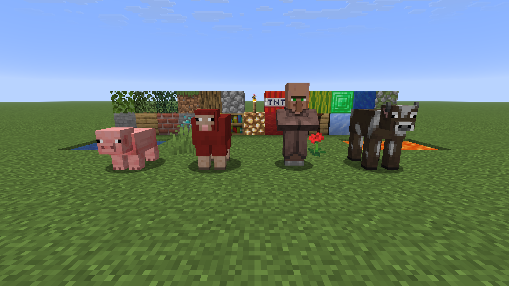
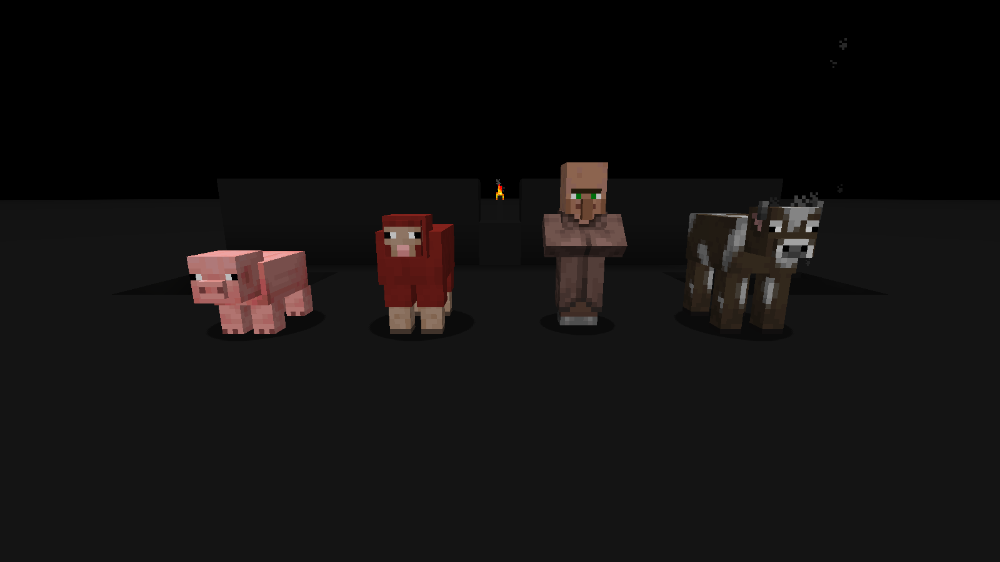

# Albedo

Albedo is a client-side Minecraft mod that lets you paint blocks, fluids, the sky, mobs and the rest of the world in any color. Give each part one flat color, or recolor its textures and keep their detail.

A plain world makes anything that moves easy to see. Albedo changes textures as they load, so it also works with modded blocks and resource packs.

| Vanilla | quake-white | quake-black |
|---|---|---|
|  |  |  |

## Install

1. Download the jar for your Minecraft version and loader.
2. Put it in your `mods/` folder.
3. Start the game.

| Minecraft | Fabric | NeoForge | Forge |
|-----------|:------:|:--------:|:-----:|
| 1.8.9     |        |          | Yes   |
| 1.21.1    | Yes    | Yes      |       |
| 1.21.11   | Yes    | Yes      |       |
| 26.3      | Yes    | Yes      |       |

On Fabric you need only Fabric Loader. You do not need Fabric API.

## Keys

| Key | What it does |
|-----|--------------|
| F9 | Opens the settings screen |
| F6 | Turns the mod on or off |
| F7 | Selects the next profile |

You can change these keys in the config file.

## Profiles

A profile is a full set of settings. Albedo comes with three:

- **quake-white** makes the world white, with fullbright on and clouds, weather and small plants hidden.
- **quake-black** is the same in near-black.
- **minimal** gives each block its own average color.

You cannot change the built-in profiles directly. When you edit one, Albedo puts your changes in a copy, such as `quake-white-custom`, and uses that copy from then on.

## Settings

Push F9 to open the settings screen. On Fabric you can also use the Config button in Mod Menu, and on NeoForge the Config button in the mod list.

The list on the left has one entry for each part of the world, such as Blocks, Mobs and entities, or Sky. Select one to change how it looks. Changes show in the world right away. Push Done to save them or Discard to drop them.

Keep the pointer on a control to see what it does.

### Styles

Each part of the world has a style:

- **Vanilla** keeps the normal textures.
- **Color** paints every texture one flat color.
- **Recolor** changes the color of each texture but keeps its detail. Use the Detail, Colors and Light sliders to tune how much of the original texture stays.
- **Average** gives each texture its own average color.
- **Gray** removes the color and keeps the detail.
- **Hide** makes the textures invisible.

The sky has three styles: Vanilla, Color (one flat color for the sky and the fog) and Layers.

### Custom sky

With the style **Layers**, you make your own sky from up to 8 layers. The first time, the sky starts from the Dusk preset. Push Dusk, Nebula, Galaxy or Meteors two times to start again from a preset. Meteors is a clear night sky with shooting stars.

There are two types of layer:

- **Make** layers paint: Gradient, Glow, Noise, Fractal, Galaxy, Stars and Meteors.
- **Change** layers change the layers below them: Blur, Crystallize, Pixelate, Posterize, Hue shift, Bloom, Swirl and Vignette. You can put many of them on top of each other.

A higher layer is drawn over the lower layers. Click a layer to edit it:

- **Look:** the blend (Normal, Add, Screen, Multiply), the opacity, the colors and the other values of the layer. "New pattern" gives a noise, fractal, galaxy or star layer a different pattern. A Stars layer has many faint stars and few bright stars, with the colors of real stars. Count sets how many stars there are, and Spikes sets the strength of the thin lines of light on the bright stars. A Galaxy layer also has a tilt (0 shows the disc from the front, 90 from its edge), dust that makes dark lanes in the disc, and two jets from its black hole with their own color.
- **Meteors:** shooting stars that move across the upper sky, each with a small white head and a thin trail that fades. Amount sets how many, Speed how fast, Length how long the trails are, and Shower how many come from one point, the radiant. Turn and Tilt on the Place page move the radiant. Some meteors are bright fireballs. Only "Sharp render" shows the meteors. The preview and the fast render do not show them. A Blur, Pixelate, Crystallize or Swirl layer above the meteors hides them, and a Bloom layer does not make them glow.
- **Mask:** the layer shows only where a lower layer is light (or dark). Set "Mask only" on the lower layer if it must not show itself. For example, a Noise layer with "Mask only" and a Blur layer above it, masked by the noise, blurs the sky only in patches.
- **Place:** Turn (the compass direction), Tilt (the height above the horizon), Roll and Size. Only the values that change the layer show.

The preview above the layers shows the sky from the zenith (the top edge) down to 15 degrees below the horizon (the white line), with north at the left. When "Full sphere" is on, it shows all of the sky, also below the horizon. The yellow dashed lines are the sun path: the sun comes up in the east, goes through the zenith and goes down in the west. On a layer page, "This layer" shows only that layer, also when it is only a mask. The sky in the world changes when you push Apply or Done.

"Show sun, moon and stars" draws the vanilla sun, moon and stars over your sky. "Darker at night" makes your sky dark at night and in rain, the same as the vanilla sky. "Full sphere" puts the layers around the full sky, also below the horizon. When it is off, the sky below the horizon goes smoothly into the color of the horizon. The fog takes the color of your sky near the horizon. The Nebula, Galaxy and Meteors skies use "Full sphere". "Sharp render" draws your sky sharp at all screen sizes and with zoom, on all versions. Blur, Bloom, Pixelate, Crystallize and Swirl stay soft, and a sky with more than 4 of these filters draws from an image of the sky. On 1.8.9, the graphics card must have OpenGL 3.0, else the sky draws from an image of the sky. Set it off if the game is slow.

### Groups

A group gives some textures a different look from the rest of their category. For example, a group can make grass and dirt green while all other blocks stay white.

To make a group, open the Groups tab and push New group. Then type the names of the textures you want in it. Albedo suggests matching names as you type. Push Enter to add one.

A few tips:

- `*` matches any text. `grass_block*` covers all sides of the grass block, and `*` alone covers the whole category.
- Text between two slashes is a regular expression, for example `/^(oak|birch)_/`.
- If a texture is in two groups, the higher group in the list wins. Use the arrows to move a group up or down.
- The Textures tab lists every texture in the category. Click one to put it in a group.

Groups work the same way on all versions, also for particles and paintings on 1.8.9.

### Servers

The Servers page lets you pick a profile for each multiplayer server, or turn Albedo off there. When you leave the server, your own profile comes back.

## Config file

All settings are saved in `config/albedo/config.json`. You can also edit this file by hand. Albedo loads your changes within one second and shows any errors in the game.

```json
{
  "enabled": true,
  "activeProfile": "my-profile",
  "keys": { "toggle": "F6", "cycleProfile": "F7", "settings": "F9" },
  "servers": { "hypixel.net": "quake-black", "example.org": false },
  "profiles": {
    "my-profile": {
      "fullbright": true,
      "shading": false,
      "blocks": {
        "mode": "solid",
        "color": "#FFFFFF",
        "groups": [
          { "name": "Ground", "match": ["dirt", "grass_block*"], "color": "#7A5C3A" },
          { "name": "Ores", "match": "*_ore", "mode": "original" }
        ]
      },
      "sky": { "mode": "solid", "color": "#202020" },
      "clouds": { "mode": "hidden" }
    }
  }
}
```

The parts of the world are `blocks`, `fluids`, `block_entities`, `decorations`, `items`, `entities`, `players`, `particles`, `block_breaking`, `sky`, `clouds` and `weather`. The styles are `original`, `solid`, `recolor`, `average`, `grayscale` and `hidden`, and `layers` for the sky.

A custom sky in the file:

```json
"sky": {
  "mode": "layers",
  "celestial": "hide",
  "light": "day_night",
  "layers": [
    { "id": 1, "kind": "gradient", "color1": "#F08A4B", "color2": "#1A1F4D", "height": 22, "amount": 45 },
    { "id": 2, "kind": "noise", "output": "mask_only", "amount": 55, "seed": 12 },
    { "id": 3, "kind": "stars", "blend": "add", "opacity": 80, "amount": 60, "seed": 3, "transform": { "scale": 150 } },
    { "id": 4, "kind": "blur", "amount": 25, "mask": { "layer": 2, "mode": "light" } }
  ]
}
```

Add `"extent": "sphere"` to put the layers around the full sky (the default is `"horizon"`). The first layer is the lowest. Each layer has its own `id`, and a `mask` can name only a lower layer. `color1`, `color2`, `amount`, `height`, `seed`, `speed`, `length` and `shower` are the values of the layer, and each kind uses only some of them. `transform` has `yaw` (0 to 359), `pitch` (-90 to 90), `roll` (-180 to 180) and `scale` (25 to 400 percent). An error message gives the place of the error, for example `my-profile.sky.layers[3].mask: no layer below this one has id 7`.

To share a profile, push Export in the settings screen. This saves it to `config/albedo/profiles/` and copies it to the clipboard. To add a profile that someone gave you, copy its text and push Import.

## Works with

- **Sodium and Embeddium:** everything works.
- **OptiFine on 1.8.9:** everything works. The sky style Layers replaces the sky of an OptiFine resource pack. When the OptiFine setting Sky is off, the sky style Layers is not drawn. With an OptiFine shader pack, the sky style Layers shows the vanilla sky, because the shader pack draws the sky. Shaders are not tested.
- **Iris:** everything works with shaders off. Many shader packs draw their own sky, clouds, light and shadows. With those packs, the sky (also Layers), clouds, fullbright, shading and shadow settings have no effect.

## Known limits

- On 1.21.2 and later, clouds can only be hidden, not colored.
- With "Sharp render" off, a custom sky has about 6 pixels for each degree of the sky, so small stars look soft on a large screen.
- When small plants are hidden, their items are hidden too.
- With OptiFine shaders or very large resource packs, a settings change reloads all resources, which can take a while.

## Contributing

To build the mod or work on it, see [docs/ARCHITECTURE.md](docs/ARCHITECTURE.md).

## License

MIT. See [LICENSE](LICENSE).
