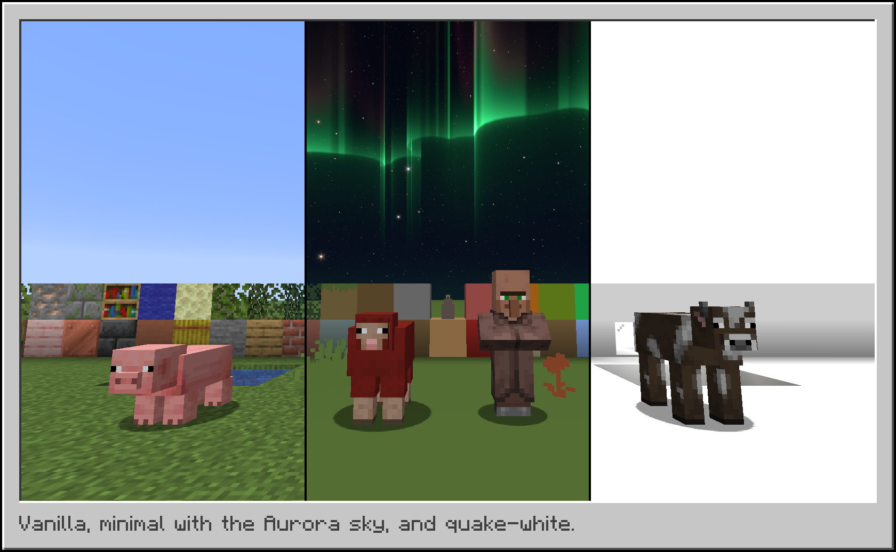

# Albedo

Albedo is a client-side Minecraft mod that lets you paint blocks, fluids, the sky, mobs and the rest of the world in any color. Give each part one flat color, or recolor its textures and keep their detail.

Albedo changes textures as they load, so it also works with modded blocks and resource packs.



## Features

### Paint the world

- **Profiles:** start from `quake-white`, `quake-black`, `minimal` or `pastel`, or make your own. Export and import them as files.
- **Looks:** give each category (blocks, fluids, mobs, players, particles, sky and more) a flat color, a recolor, the average color, gray, or hide it.
- **Effects:** Bevel shades the edges of each block, Outline draws a line around it, and Chroma moves its colors through all hues.
- **Groups:** give a set of textures their own look, for example dirt, grass and gravel in one color.

### Build your sky

- **Layers:** stack gradients, glows, clouds, stars, galaxies, meteors and auroras, with filters such as blur and bloom.
- **Presets:** Dusk, Nebula, Galaxy, Meteors, Aurora and Trails.
- **Stars:** the colors of real stars, from blue-white to orange, with a soft glow, fine spikes and twinkle.
- **Motion:** the sky turns around a pole like the real night sky, with optional star trails.
- **Sharp:** your graphics card draws each pixel, so the sky stays sharp at all zoom levels.

### Control

- **Servers:** give each server its own profile, or turn the mod off there.
- **World options:** fullbright, shading, foliage and entity shadows.
- **Keys:** F9 opens the settings, F6 turns the mod on or off, and F7 selects the next profile.

## Install

Put the jar for your Minecraft version and loader in your `mods/` folder. Fabric API is not needed. On Quilt, use the Fabric jar.

| Minecraft | Fabric | Quilt | NeoForge | Forge | Fabric jar also runs on |
|-----------|:------:|:-----:|:--------:|:-----:|-------------------------|
| 1.8.9     |        |       |          | Yes   |                         |
| 1.12.2    |        |       |          | Yes   |                         |
| 1.16.5    | Yes    | Yes   |          | Yes   |                         |
| 1.17.1    | Yes    | Yes   |          | Yes   |                         |
| 1.18.2    | Yes    | Yes   |          | Yes   |                         |
| 1.19.2    | Yes    | Yes   |          | Yes   | 1.19, 1.19.1            |
| 1.19.4    | Yes    | Yes   |          | Yes   | 1.19.3                  |
| 1.20.1    | Yes    | Yes   |          | Yes   | 1.20                    |
| 1.20.4    | Yes    | Yes   | Yes      | Yes   | 1.20.3                  |
| 1.20.6    | Yes    | Yes   | Yes      |       | 1.20.5                  |
| 1.21.1    | Yes    | Yes   | Yes      |       | 1.21                    |
| 1.21.3    | Yes    | Yes   | Yes      |       | 1.21.2                  |
| 1.21.4    | Yes    | Yes   | Yes      |       |                         |
| 1.21.5    | Yes    | Yes   | Yes      |       |                         |
| 1.21.8    | Yes    | Yes   | Yes      |       | 1.21.6, 1.21.7          |
| 1.21.10   | Yes    | Yes   | Yes      |       | 1.21.9                  |
| 1.21.11   | Yes    | Yes   | Yes      |       |                         |
| 26.1.2    | Yes    |       | Yes      |       | 26.1, 26.1.1            |
| 26.2      | Yes    |       | Yes      |       |                         |
| 26.3      | Yes    |       | Yes      |       |                         |

The NeoForge 1.21.1 jar also runs on 1.21.

## Config file

All settings are in `config/albedo/config.json`, including the keys. Albedo loads a change to the file within one second and shows any error in the game, with its place in the file.

```json
{
  "activeProfile": "my-profile",
  "servers": { "hypixel.net": "quake-black" },
  "profiles": {
    "my-profile": {
      "fullbright": true,
      "blocks": {
        "mode": "solid",
        "color": "#FFFFFF",
        "groups": [{ "name": "Ground", "match": ["dirt", "grass_block*"], "color": "#7A5C3A" }]
      },
      "clouds": { "mode": "hidden" }
    }
  }
}
```

## Compatibility

- **Sodium, Embeddium and Rubidium:** everything works. Tested with the newest release of each for every Minecraft version.
- **Vulkan on 26.2 and later:** everything works with both the OpenGL and the Vulkan backend.
- **OptiFine on 1.8.9:** everything works. The custom sky needs the OptiFine Sky setting on. With an OptiFine shader pack, the sky stays vanilla.
- **OptiFine on other versions:** not supported.
- **Iris:** everything works with shaders off. Many shader packs draw their own sky, light and shadows. On 1.17.1 to 1.21.5 with a shader pack, the custom sky and its fog color stay vanilla.

## Known limits

- On 1.21.2 and later, you can only hide clouds, not color them.
- Hidden foliage also hides the items of those plants.

## Contributing

To build the mod, see [docs/BUILDING.md](docs/BUILDING.md). For how it works, see [docs/ARCHITECTURE.md](docs/ARCHITECTURE.md).

## License

Apache License 2.0. See [LICENSE](LICENSE).
