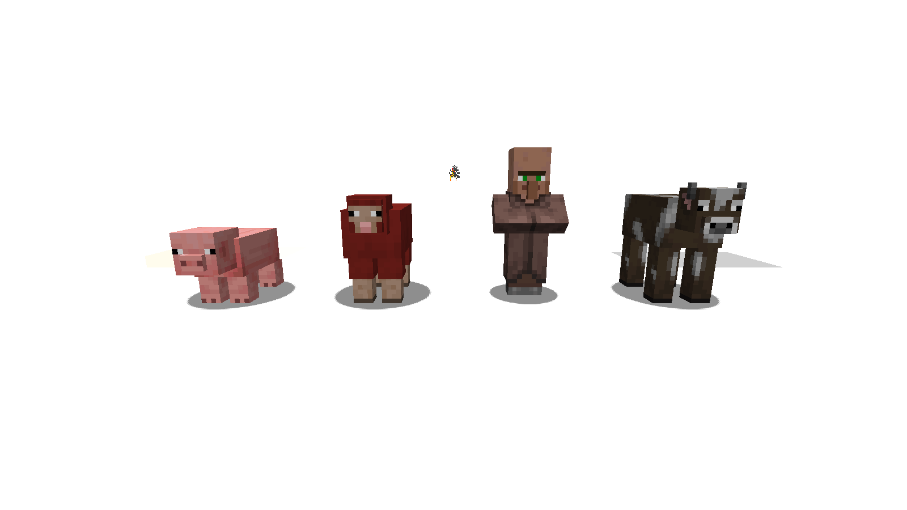
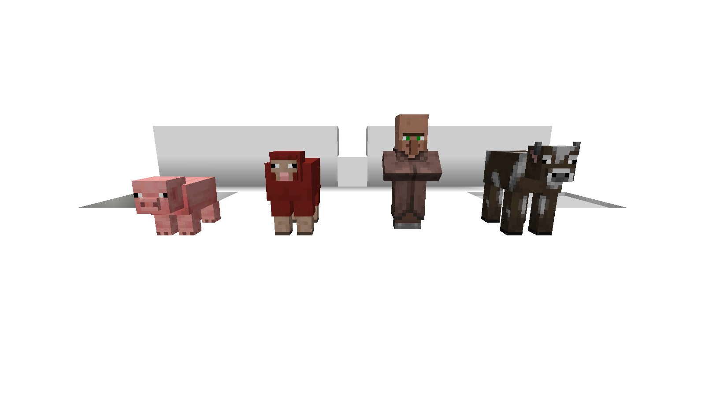
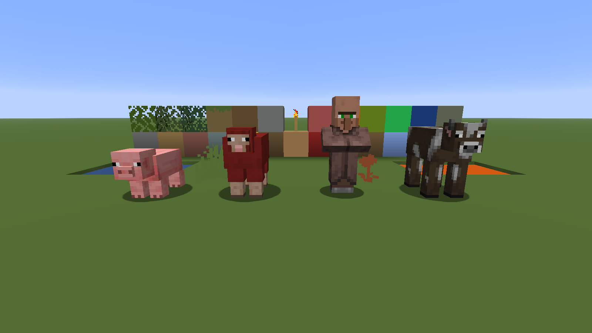
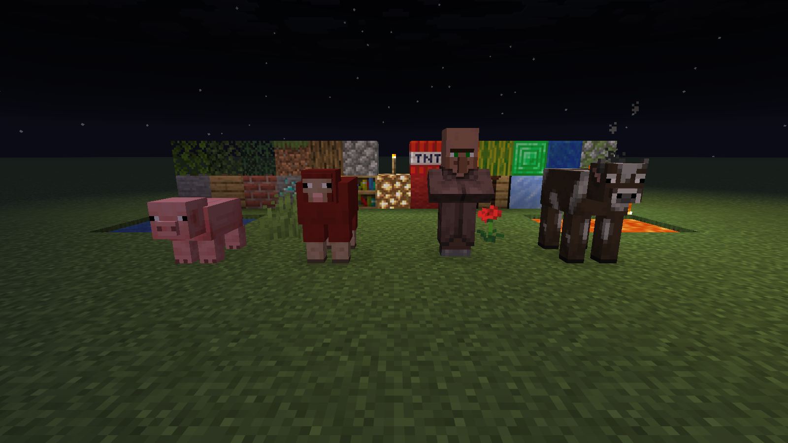
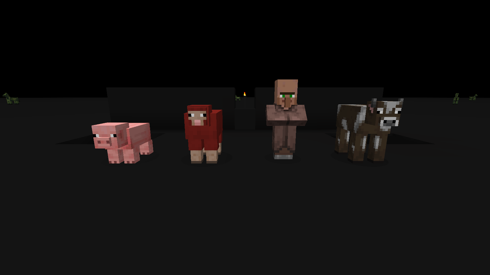
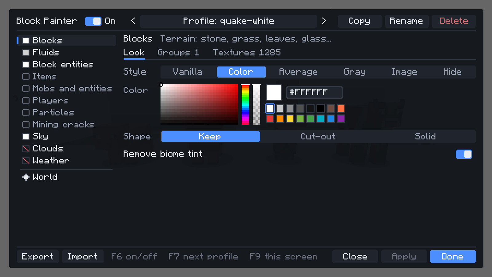

# Albedo

Albedo is a client-side Minecraft mod. It changes blocks, fluids, sky, mobs and other parts of the world to one flat color.

It works like the flat "Quake" texture packs: things that move are easy to see. The mod changes textures as they load, so it also works with modded blocks and other resource packs.

| Vanilla | Quake white | Quake white, shading off |
|---|---|---|
|  |  |  |

| Quake white, shadows off | Quake black | Minimal |
|---|---|---|
|  |  |  |

| Night, vanilla | Night, quake black and fullbright | Settings screen |
|---|---|---|
|  |  |  |

The screenshots show Fabric 26.3. Screenshots for the other versions are in [docs/screenshots](docs/screenshots).

## Supported versions

| Minecraft | Fabric | NeoForge | Forge |
|-----------|:------:|:--------:|:-----:|
| 1.8.9     |        |          | Yes   |
| 1.21.1    | Yes    | Yes      |       |
| 1.21.11   | Yes    | Yes      |       |
| 26.3      | Yes    | Yes      |       |

The Fabric jar needs only Fabric Loader. It does not need Fabric API.

## Install and use

1. Put the jar for your loader and Minecraft version in the `mods/` folder.
2. Start the game.
3. Push F9 to open the settings screen.

| Key | Action |
|-----|--------|
| F9 | Open the settings screen. The Config button in Mod Menu or in the NeoForge mod list also opens it. |
| F6 | Turn the mod on or off. |
| F7 | Select the next profile. |

You can change the keys in the config file.

### Profiles

| Profile | Result |
|---------|--------|
| `quake-white` | Blocks, block entities and sky are white. Signs, banners, paintings and maps are light gray. Leaves are solid. Fluids are light gray. The profile removes biome tint and hides foliage, clouds and weather. Fullbright is on. |
| `quake-black` | The same as `quake-white`, in near-black. Signs, banners, paintings and maps are mid gray, so that their text stays readable. |
| `minimal` | Each block becomes its own average color. |

These three profiles are built in. You cannot rename, delete or change them. When you change a built-in profile, the mod puts the change in a new profile, for example `quake-white-custom`, and selects it. The config file keeps only your own profiles, so an update can improve the built-in profiles.

### Settings screen

- **Profile bar:** click the profile name to open the profile list. Type to search, push Up or Down to select, and push Enter. Copy makes a new profile from the active one. Rename and Delete are for your own profiles. To rename, type the name and push Enter or Save. Esc or Cancel keeps the old name.
- **Delete:** a profile or group delete needs two clicks. The first click makes the button red. Click it again in 3 seconds to delete. Esc or a click on a different control cancels.
- **Tooltips:** keep the pointer on a control to see what it does.
- **Export and Import:** Export saves the profile to `config/albedo/profiles/<name>.json` and copies it to the clipboard. To add a profile, copy the text of a profile file and push Import. Import never replaces a profile. If the name is in use, it adds a number. The result shows in a message box for some seconds. A click closes it.
- **Categories (left list):** each category has a color square that shows its current color.
- **World page:** Fullbright, Shading (smooth lighting and darker block sides), Foliage (grass, flowers, ferns, vines and other small plants) and Entity shadows.
- **Look tab:** style (Vanilla, Color, Average, Gray, Image, Hide), color picker with hex field and palette, shape (Keep, Cut-out, Solid), and Remove biome tint for blocks and fluids.
- **Textures tab:** all loaded textures of the category. Type in the search field to find a texture. Click a texture to put it in a group.
- **Groups tab:** a group is a named set of textures with its own look: blocks, particles, mobs or other textures of the category. Use the arrows to move a group up or down.

To add textures to a group, type a name. The input shows matching textures of the category, with whole blocks first (for example, `grass_block*` covers all faces, and `generic*` covers all frames of a particle). Push Up or Down to select a texture. Push Enter to add it. Push Tab to complete the name. Each pattern shows as a chip with a remove button. Two kinds of pattern:

- **Name with wildcards:** `*` matches any text, so `*` alone selects all textures of the category, and `?` matches one character. The pattern must match the whole name.
- **Regular expression:** text between two slashes, for example `/^(oak|birch)_/`. It can match any part of the name. Case does not matter. The input shows an error if the expression is not valid.

A pattern without `:` ignores the namespace: `stone` matches `minecraft:stone`.

If a block is in two groups, the higher group in the list wins. Each category has a scope:

- **Everything:** the category look applies to all blocks, and groups change their blocks. A group set to Vanilla keeps its blocks unchanged.
- **Only groups:** only blocks in groups change. A group set to Global uses the category look.

The footer shows "Changes not saved" when there are changes. Apply saves and shows the result. Done or Esc saves and closes the screen. Discard closes the screen and does not save. Changes show immediately: the mod repaints only the textures that change, usually in less than 0.1 seconds, and does not reload resources. If a repaint is not possible (OptiFine shaders, or very large resource packs), the mod reloads resources and shows a progress bar.

## Config file

The settings are in `config/albedo/config.json`. You can edit this file by hand. The mod reloads it within one second and shows errors in game with their location. Unknown keys are errors.

```json
{
  "enabled": true,
  "activeProfile": "my-profile",
  "keys": { "toggle": "F6", "cycleProfile": "F7", "settings": "F9" },
  "profiles": {
    "my-profile": {
      "fullbright": true,
      "shading": false,
      "foliage": false,
      "shadows": true,
      "blocks": {
        "mode": "solid",
        "color": "#FFFFFF",
        "removeTint": true,
        "groups": [
          { "name": "Ground", "match": ["dirt", "grass_block*", "gravel"], "color": "#7A5C3A" },
          { "name": "Leaves", "match": "*leaves*", "alpha": "opaque" },
          { "name": "Ores", "match": "*_ore", "mode": "original" }
        ]
      },
      "fluids": { "mode": "solid", "color": "#D0D0D0", "removeTint": true },
      "sky": { "mode": "solid", "color": "#202020" },
      "clouds": { "mode": "hidden" }
    }
  }
}
```

- **Profile toggles:** `fullbright`, `shading`, `foliage`, `shadows`.
- **Category keys:** `blocks`, `fluids`, `block_entities`, `decorations` (signs, banners, paintings, maps, item frames), `items`, `entities`, `players`, `particles`, `block_breaking`, `sky`, `clouds`, `weather`.
- **Category fields:** `mode`, `color`, `texture`, `alpha`, `removeTint`, `onlyGroups`, `groups`.
- **`mode`:** `original`, `solid`, `average`, `grayscale`, `texture` or `hidden`. Sky supports `original` and `solid`. Clouds support `original` and `hidden`. Weather supports `original`, `solid` and `hidden`.
- **`color`:** `#RGB`, `#RRGGBB`, `#AARRGGBB` or a name such as `white`.
- **`texture`:** a PNG file name in `config/albedo/textures/`.
- **`alpha`:** `keep`, `binary` or `opaque`.
- **Group fields:** `name`, `match` (a pattern or a list of patterns; a pattern between slashes is a regular expression), and `mode`, `color`, `texture`, `alpha`. A field that the group does not set comes from the category. A group with no look fields uses the category look.

## Building

You need JDK 21 and JDK 25. If JDK 8 is missing, Gradle gets it for 1.8.9.

```bash
cd modern && ./gradlew collectJars   # Fabric and NeoForge jars -> modern/build/libs/
cd legacy && ./gradlew build         # 1.8.9 Forge jar -> legacy/build/libs/
cd modern && ./gradlew :core:test    # tests
```

To start a dev client, run `./gradlew :fabric:26.3:runClient` in `modern/` (any loader or version) or `./gradlew runClientDev` in `legacy/`.

For design details, see [docs/ARCHITECTURE.md](docs/ARCHITECTURE.md).

## Releases

See [docs/RELEASING.md](docs/RELEASING.md). In short: write the version's section in [CHANGELOG.md](CHANGELOG.md), then push a tag such as `v1.0.0`. CI builds all jars, makes a GitHub release with the changelog section as notes, and uploads the jars to Modrinth (slug `albedo`) if the repository variable `MODRINTH_PROJECT_ID` and the secret `MODRINTH_TOKEN` exist.

## License

MIT. See [LICENSE](LICENSE).

## Screenshots

`tools/screenshots.ps1` (Windows) starts each version on a hidden desktop with sound and narrator off. It builds a test scene and saves the screenshots to `docs/screenshots/<target>/`.

## Known limits

- Sodium and Embeddium: all features operate. Tests used Sodium 0.8.13 to 0.9.3 and Embeddium 1.0.15. A different version of these mods can stop the block tint change.
- 1.8.9 with OptiFine: all features operate. Tests used OptiFine HD U M6 pre2 and HD U L5. Shaders are not tested.
- 1.8.9: a settings change repaints the changed textures and, for tint and shading, rebuilds the chunks. This takes less than 0.1 s. With OptiFine shaders, with a texture type from a different mod, or with more than 128 MB of textures, the mod reloads all resources. On a slow computer this can take 20 s. A progress bar shows during the reload.
- On 1.21.2 and later, you can only hide clouds.
- Downloaded player skins do not change.
- Hidden foliage also hides the items of those plants.
- On 1.8.9, all particles are one texture, so groups in the Particles category have no effect there.
