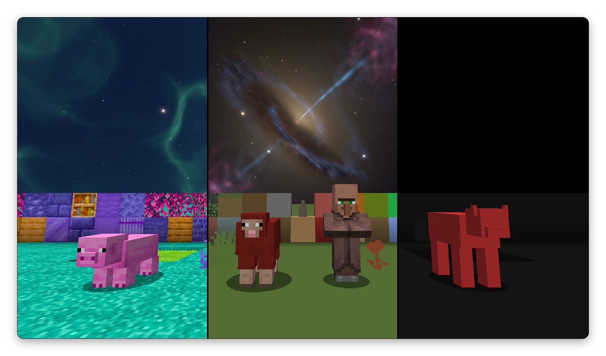

# Albedo

Albedo is a client-side mod that lets you paint blocks, fluids, the sky, mobs and the rest of the world in any color. Give each part one flat color, or recolor its textures and keep their detail.

Textures are changed as they load, so modded blocks and resource packs work too.

## Features

### Paint the world

- **Profiles:** start from `quake-white`, `quake-black`, `minimal` or `pastel`, or make your own. Export and import them as files.
- **Looks:** give each category (blocks, fluids, mobs, players, particles, sky and more) a flat color, a recolor, its average color, gray, or hide it.
- **Effects:** Bevel shades block edges, Outline draws a line around the shape of each block and item, and Chroma cycles colors through every hue, on the whole texture or only on its edge.
- **Groups:** give a set of textures their own look, for example dirt, grass and gravel in one color.

### Build your sky

- **Layers:** stack gradients, glows, clouds, stars, galaxies, deep fields, meteors and auroras, with filters such as blur and bloom.
- **Presets:** pick Dusk, Nebula, Galaxy, Meteors, Aurora or Trails from a gallery that shows an image of each.
- **Stars:** real star colors from blue-white to orange, with a soft glow, fine spikes and twinkle.
- **Motion:** the sky turns around a pole like the real night sky, with optional star trails.
- **Sharp:** drawn per pixel on the GPU, so it stays sharp at any zoom.

### Control

- **Servers:** give each server its own profile, or turn the mod off there.
- **World options:** fullbright, shading, foliage, entity shadows, player armor and player capes.
- **Keys:** F9 opens the settings, F6 turns the mod on or off, F7 switches profile.

## Versions

| Loader   | Minecraft |
|----------|-----------|
| Fabric   | 1.16.5, 1.17.1, 1.18.2, 1.19 to 1.20.1, 1.20.3 to 1.21.11, 26.1 to 26.3 |
| Quilt    | 1.16.5, 1.17.1, 1.18.2, 1.19 to 1.20.1, 1.20.3 to 1.21.11 |
| NeoForge | 1.20.4, 1.20.6, 1.21, 1.21.1, 1.21.3, 1.21.4, 1.21.5, 1.21.8, 1.21.10, 1.21.11, 26.1.2, 26.2, 26.3 |
| Forge    | 1.8.9, 1.12.2, 1.16.5, 1.17.1, 1.18.2, 1.19.2, 1.19.4, 1.20.1, 1.20.4 |

Each version has its own file. The Fabric file also works on Quilt. Fabric API is not needed.

## Compatibility

- **Sodium, Embeddium and Rubidium:** everything works. Tested with Sodium on most Fabric versions and with Embeddium or Rubidium on most Forge versions.
- **OptiFine:** supported on 1.8.9 only. Turn on the OptiFine Sky setting to see the custom sky. With an OptiFine shader pack, the sky stays vanilla.
- **Iris:** everything works with shaders off. Many shader packs draw their own sky, light and shadows.
- **Vulkan:** works on 26.2 and later.

## Known limits

- On 1.21.2 and later, clouds can only be hidden, not colored.
- Hidden foliage also hides the item of that plant.

## Source and license

Source code and issues on [GitHub](https://github.com/wvvern/albedo). Apache License 2.0.

Not affiliated with the 2017 Albedo colored-lighting mod by elucent.
